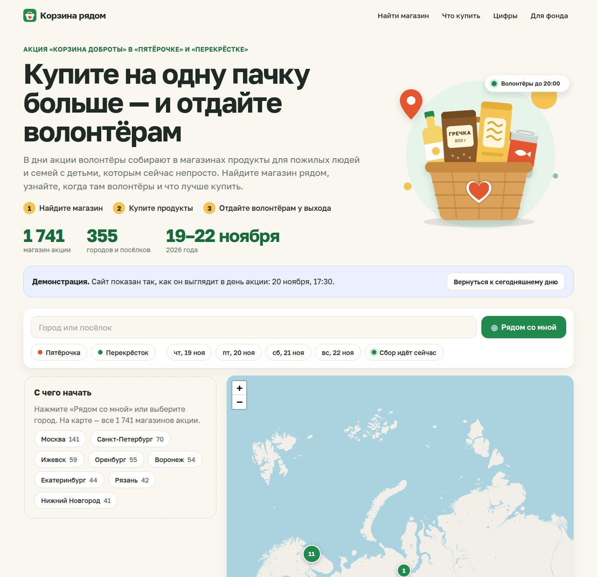
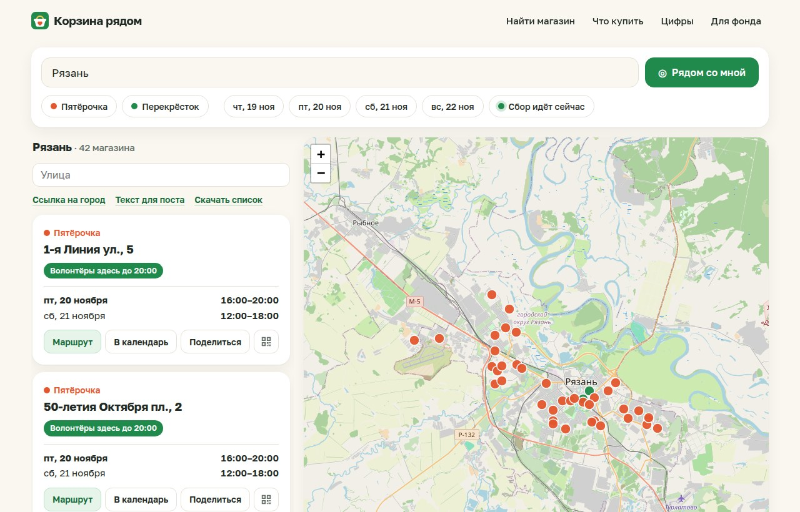
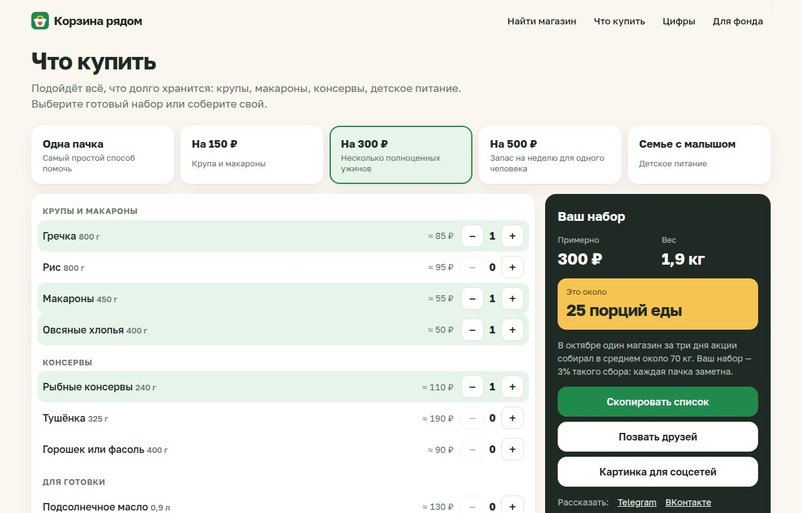
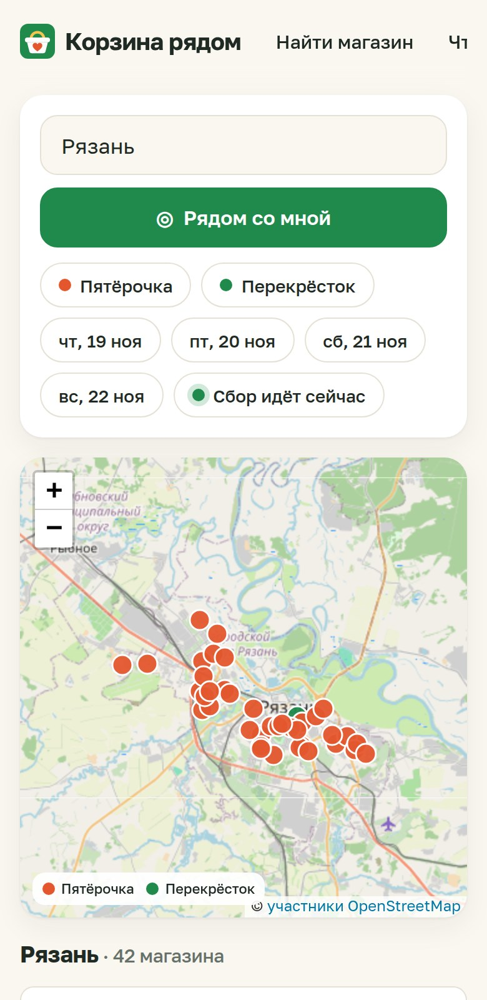

# Корзина рядом

Помощник покупателя для акции «Корзина доброты» фонда «Выручаем»: где ближайший магазин-участник, когда там волонтёры и что купить.

**Сайт: https://2lotrouble.github.io/korzina-ryadom/** · [как он выглядит в день акции](https://2lotrouble.github.io/korzina-ryadom/?demo=2026-11-20T17:30)

Сделано для конкурса [«Вайбкодинг добрых дел»](https://habr.com/ru/companies/X5Tech/articles/1111190/) в Claude Code с виджетом X5 Клуба.



| Магазины города в день акции | Что купить | С телефона |
|---|---|---|
|  |  |  |

## Какую задачу решает

Раз в месяц покупатели «Пятёрочки» и «Перекрёстка» могут купить продукты и передать их волонтёрам у выхода — фонд отправит их пожилым людям и семьям с детьми. В ноябре 2026 года в акции участвовал 1 741 магазин в 355 городах и посёлках.

Список магазинов фонд публикует таблицей. В ней 1 741 строка, адреса записаны по-юридически («Дом 78, пом. №№ 1, 2, 2а, 2б…»), а время — тринадцатью разными способами. Чтобы понять, участвует ли магазин у дома и когда туда идти, таблицу нужно листать вручную.

«Корзина рядом» берёт ту же таблицу и превращает её в сайт, которым удобно пользоваться с телефона.

## Что умеет

**Для покупателя**

- Кнопка «Рядом со мной» и поиск по городу: ближайшие магазины списком и на карте.
- Понятный адрес и расписание: «пр-т Ленина, 56 · пт, 20 ноября · 15:00–19:00».
- Статус магазина: «Волонтёры здесь до 20:00», «Сегодня с 16:00», «Завтра с 12:00».
- Маршрут в один тап, напоминание в календарь, ссылка на магазин для друзей.
- «Что купить»: готовые наборы на 150, 300 и 500 ₽ или свой набор, список можно скопировать в заметки.
- Картинка «Я покупаю на одну пачку больше» для соцсетей.

**Для фонда и партнёрских НКО**

- [Проверка таблицы](https://2lotrouble.github.io/korzina-ryadom/?view=check) прямо в браузере: видно, как покупатели увидят каждую строку и что стоит поправить. Файл никуда не отправляется.
- Код для встраивания карты в новость об акции ([пример](https://2lotrouble.github.io/korzina-ryadom/?view=embed)).
- Плакат на A4 с QR-кодом для каждого магазина ([общий плакат](https://2lotrouble.github.io/korzina-ryadom/?view=poster)).
- Ссылка на все магазины города для региональных постов ([пример: Рязань](https://2lotrouble.github.io/korzina-ryadom/?city=Рязань)) и готовый текст объявления с адресами и временем — кнопка «Текст для поста» над списком города.
- [Точки на карте](https://2lotrouble.github.io/korzina-ryadom/?view=points): если магазин нашёлся только до города, его можно поставить на место кликом по карте.
- Обновление к новой акции одной кнопкой, без программиста (см. ниже).
- Раздел «Акция в цифрах»: магазины по регионам и по дням.

## Как обновить сайт к следующей акции

**Без программиста, с сайта GitHub**

1. Открыть вкладку [Actions → «Новая таблица акции»](https://github.com/2lotrouble/korzina-ryadom/actions/workflows/update.yml) и нажать Run workflow.
2. Вставить ссылку на Google-таблицу со списком магазинов и месяц акции, например `2026-12`.
3. Подождать. Таблица скачается и проверится, для новых адресов найдутся координаты, сайт пересоберётся и опубликуется. Адреса, которые уже встречались в прошлых акциях, заново не ищутся.

Если таблица не открыта по ссылке или в ней нет нужных колонок, запуск остановится с понятным сообщением, а сайт останется прежним.

**То же самое вручную**

```bash
npm run data:fetch -- --url "ссылка на таблицу" --id 2026-12   # скачать и проверить таблицу
npm run data                                                   # координаты и данные для сайта
npm run build                                                  # готовый сайт в папке dist
```

**Если точка стоит не там**

На странице [«Точки на карте»](https://2lotrouble.github.io/korzina-ryadom/?view=points) выберите магазин и кликните по карте. Страница отдаст файл `overrides.json` — его нужно положить в папку `data` (на GitHub: Add file → Upload files). Правка привязана к адресу, поэтому сохранится и для следующих акций.

Сервера и базы данных нет: сайт — это набор файлов, его можно выложить на любой хостинг. Адрес сайта для картинки-превью задаётся в файле `.env`.

Сразу после акции сайт сам переключается в режим «акция прошла», а кнопка «Показать, как сайт выглядит в день акции» (или `?demo=2026-11-20T17:30`) показывает его так, как он работает во время сбора.

## Как устроено

| Папка | Что внутри |
|---|---|
| `data/raw/` | таблица фонда как есть |
| `data/geocoded.json` | найденные координаты: адрес из таблицы → точка |
| `data/overrides.json` | точки, поставленные вручную (файла нет, пока правок не было) |
| `scripts/fetch-table.mjs` | скачивает таблицу новой акции по ссылке и проверяет её |
| `scripts/lib/` | разбор CSV, адресов и времени; эти же модули работают в браузере на странице проверки |
| `scripts/geocode.mjs` | поиск координат в открытых данных OpenStreetMap (Photon, запасной — Nominatim), с кэшем и проверкой результата |
| `scripts/build-data.mjs` | сборка `public/data/campaign.json`, с которым работает сайт |
| `src/` | сайт: React, TypeScript, карта Leaflet |
| `.github/workflows/` | публикация на GitHub Pages, обновление таблицы одной кнопкой, выкладка на обычный хостинг по FTP |

```bash
npm install
npm run dev      # сайт на http://localhost:5173
npm test         # тесты разбора адресов, времени и статусов
npm run data     # пересобрать данные из таблицы
npm run build    # готовый сайт в папке dist
```

## Насколько точны данные

- Адреса и время берутся из таблицы фонда без ручных правок.
- Координаты ищутся автоматически и проверяются: должны совпасть регион, улица и номер дома, а точка — лежать рядом с центром своего города. В ноябрьской таблице до дома найдено 1 530 адресов из 1 741, до улицы — 182, только до города — 28. Если дом не нашёлся, точка ставится на улицу или в центр города, и сайт прямо пишет, что место примерное, и показывает исходный адрес.
- Время сравнивается с часами устройства: человек ищет магазин рядом с собой, поэтому местное время магазина и местное время покупателя совпадают.
- Цены в наборах примерные. Они лежат в `src/lib/basket.ts`, их легко заменить реальными.

## Чего здесь нет

Учёта для волонтёров и распределения помощи: этим занимается собственная платформа фонда. «Корзина рядом» закрывает другой участок — путь покупателя до магазина.

## Оговорка

Проект неофициальный и не связан с X5 Group и фондом «Выручаем». Данные — из открытой таблицы фонда. Карта: © участники OpenStreetMap.

## Лицензия

MIT
